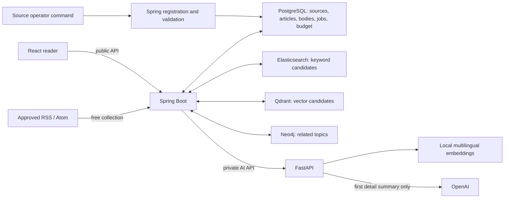

# Sigak

[English](README.md) | [한국어](README.ko.md)

Sigak helps developers read engineering blogs and development updates across AI, software development, and computer science. It provides Korean AI summaries when an article is first opened, then shares the saved result across readers.

The v0.1 portfolio MVP focuses on a small but complete AI search flow: selected-source collection, PostgreSQL persistence, Elasticsearch keyword search, Qdrant vector search, Neo4j graph projection, hybrid retrieval, and graph-aware article detail.

## Reading flow

1. Register a blog or RSS/Atom URL, inspect three original/body samples, then enable the source.
2. Collection publishes source metadata without paid AI and prepares complete bodies in the background.
3. First detail entry requests a shared asynchronous summary; subsequent visits reuse it.
4. Search and related topics help connect the article to other technical material.

Source setup uses PostgreSQL rather than a code list. Standard feeds work automatically;
exceptions use body/exclusion selectors. See [source operations](docs/SOURCE_OPERATIONS.ko.md).

As of 2026-11-02, collection is enabled only for Toss, Woowahan and NAVER D2. Home shows
real articles from enabled sources, excluding demos. Earlier sources are paused; their articles
and summary history remain stored, searchable and readable by direct link.

## Architecture

- `backend/`: Spring Boot main backend and REST API.
- `frontend/`: React + TypeScript + Vite frontend.
- `ai/`: FastAPI service for AI/RAG-related capabilities.
- `experiments/`: retrieval and graph-aware smoke evaluation artifacts.
- `infra/`: Docker Compose and local development infrastructure.
- `docs/`: product, roadmap, API, research strategy, status, and architecture decisions.

Spring Boot is the public API boundary. The frontend calls Spring Boot, and Spring Boot calls FastAPI only for AI/RAG-specific work such as embeddings and on-demand enrichment. PostgreSQL is the source of truth; Elasticsearch, Qdrant, and Neo4j are rebuildable projection stores.



## MVP Scope
- News article list
- News article detail
- Elasticsearch-backed keyword search
- FastAPI-backed embedding boundary
- Qdrant-backed vector search
- RRF-based hybrid search
- Neo4j-backed relation reasons on article detail
- On-demand AI summaries of complete supported article bodies
- Importance and why-it-matters insight
- Graph RAG-ready article metadata
- Local retrieval and graph-aware smoke reports
- Simple frontend UI
- Docker Compose local setup

## Current Status
Sigak now has a connected v0.1 backend slice and a frontend reading flow. Public article APIs expose API-ready PostgreSQL articles only, article detail loads related articles in bulk, and the frontend displays graph relation reasons when Neo4j context is available.

The PostgreSQL source registry supports URL discovery, free sample validation, activation and pause without redeployment. RSS/Atom full bodies and excerpts are preserved separately; verified feeds can provide bodies without another page request. The collection pipeline also retains its existing arXiv connector, deduplicates and publishes raw articles without paid AI. First actual detail entry asynchronously requests a Korean summary; the saved result is shared across visitors. Published articles remain readable and searchable without enrichment. The persistent application allowance stops at $4 within the approved $5 total; development mock mode remains available.

The implemented `/research` route is a read-only evidence view for the portfolio flow. It calls `GET /api/research/overview` to present committed retrieval comparison, graph-aware smoke, and expanded catalog artifacts; it does not run experiments or rebuild projections from the browser.

```http
GET /api/articles
GET /api/articles?query={query}
GET /api/articles?ids={id1},{id2}
GET /api/articles/{id}
GET /api/articles/{id}/graph-context
GET /api/articles/{id}/summary
POST /api/articles/{id}/summary
GET /api/research/overview
```

Public search uses Elasticsearch keyword candidates and Qdrant vector candidates for non-blank queries, fuses them with reciprocal rank fusion, and reloads final responses from PostgreSQL. If one projection path fails, search degrades to keyword-only or vector-only; if both fail, it falls back to PostgreSQL field filtering. Neo4j stores rebuildable article-topic and article-article graph context for relation reasons on detail pages.

The current evaluation artifacts are intentionally smoke-sized. The latest committed retrieval comparison and graph-aware evaluation use the preserved `api-ready-2026-06-02` catalog with 3 reviewed queries. A larger 41-article catalog exists at `experiments/datasets/raw/articles.catalog.api-ready-2026-06-05.json`, but expanded benchmark claims are deferred until reviewed labels exist for that catalog.

## Run Locally
From the repository root, start PostgreSQL, search infrastructure, graph infrastructure, and the AI server:

```bash
docker compose -f infra/docker-compose.yml up -d --pull never postgres elasticsearch qdrant neo4j ai
```

Start the backend:

```bash
cd backend
./gradlew bootRun
```

After the backend starts, rebuild the projections from another terminal:

```bash
curl -X POST http://localhost:8080/api/internal/search-projections/articles/rebuild
curl -X POST http://localhost:8080/api/internal/search-projections/article-vectors/rebuild
curl -X POST http://localhost:8080/api/internal/graph-projections/articles/rebuild
```

Run public search and graph context checks:

```bash
curl "http://localhost:8080/api/articles?query=graph"
curl http://localhost:8080/api/articles/4/graph-context
curl http://localhost:8080/api/internal/search-metrics/articles
```

Start the frontend in another terminal:

```bash
cd frontend
npm install
npm run dev
```

Local URLs:

```txt
http://localhost:5173
http://localhost:8080/swagger-ui/index.html
http://localhost:8080/api/articles
http://localhost:5173/research
```

For the full reproducible backend demo, follow [Local Demo Flow](docs/DEMO_FLOW.md).

## Evaluation Artifacts
Smoke artifacts are committed to show that the evaluation pipeline is reproducible, not to claim final search quality.

```bash
node -e "const s=require('./experiments/results/retrieval/latest/metrics.comparison.json'); console.log(JSON.stringify({catalogId:s.catalogId,evaluatedQueryCount:s.evaluatedQueryCount,systems:s.systems.map((system)=>system.system),warnings:s.warnings}, null, 2))"
node -e "const s=require('./experiments/results/graph/latest/graph-context.metrics.summary.json'); console.log(JSON.stringify({catalogId:s.catalogId,evaluatedQueryCount:s.evaluatedQueryCount,macroGraphContextCoverageAtK:s.macroGraphContextCoverageAtK,warnings:s.warnings}, null, 2))"
```

Expected signal:

- `catalogId` is `api-ready-2026-06-02`.
- `evaluatedQueryCount` is `3`.
- warnings explicitly mark the artifacts as smoke-only.
- expanded 41-article benchmark results are not claimed until `api-ready-2026-06-05` labels are reviewed.

## Operations-Document Retrieval Evaluation

The [retrieval harness](experiments/rag-evaluation/README.md) provides fixed/heading chunking, BM25/dense/hybrid baselines, evidence validation, and reproducible smoke artifacts. Its [60-query draft](experiments/rag-evaluation/datasets/review.md) requires human review before full evaluation. Generation, reranking, and LLM judging remain pending.

## Source and summary limits

Adding a URL does not guarantee that a site can be collected. Multiple feeds, unusual HTML,
server blocks and incomplete input need explicit handling. Oversized bodies are not truncated
or split into extra paid calls. arXiv full papers and personalized/career-specific filtering
remain outside this slice. New-source summary quality needs separate evaluation; body checks
alone do not demonstrate AI quality.

## Single-Server Deployment

Run the compiled UI and real Spring Boot API at one origin with the [deployment guide](infra/deploy/README.md). The deployment Compose stack publishes only the Caddy web service, defaults to `http://127.0.0.1:8088`, and keeps separate persistent volumes. Its fresh database starts with five seed articles and automatically collects registered technical-news sources every ten minutes after completion; existing development data is preserved separately. Permanent Internet hosting still requires a cloud host and domain; the guide also describes a temporary Cloudflare preview.

## Project Structure
```txt
sigak/
├── ai/
├── backend/
├── docs/
│   ├── PRODUCT.md
│   ├── ROADMAP.md
│   ├── STATUS.md
│   ├── RESEARCH_STRATEGY.md
│   ├── DEMO_FLOW.md
│   ├── ko/
│   └── decisions/
├── experiments/
├── frontend/
├── infra/
│   └── docker-compose.yml
├── AGENTS.md
├── README.md
└── .env.example
```

## Documentation
- [Documentation Index](docs/README.md)
- [Product](docs/PRODUCT.md)
- [Roadmap](docs/ROADMAP.md)
- [Status](docs/STATUS.md)
- [Local Demo Flow](docs/DEMO_FLOW.md)
- [Research Strategy](docs/RESEARCH_STRATEGY.md)
- [API Spec](docs/API_SPEC.md)
- [Source Policy](docs/SOURCE_POLICY.md)
- [Korean Guide](docs/ko/GUIDE.md)
- [Initial Architecture ADR](docs/decisions/0001-initial-architecture.md)
- [Product Scope and Graph RAG Strategy ADR](docs/decisions/0002-product-scope-and-graph-rag-strategy.md)
